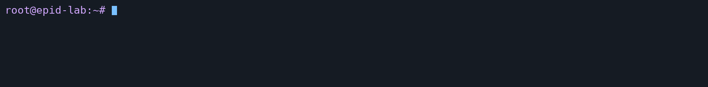

<p align="center">
  
</p>

```console
root@epid-lab:~# cat /etc/motd

██╗ ██╗██╗ ██╗███████╗██████╗ ████████╗ █████╗ ██╗  ██╗
██║ ██║██║ ██║██╔════╝██╔══██╗╚══██╔══╝██╔══██╗██║ ██╔╝
██████║██║ ██║█████╗  ██████╔╝   ██║   ███████║█████╔╝
╚═══██║██║ ██║██╔══╝  ██╔══██╗   ██║   ██╔══██║██╔═██╗
    ██║╚████╔╝███████╗██║  ██║   ██║   ██║  ██║██║  ██╗
    ╚═╝ ╚═══╝ ╚══════╝╚═╝  ╚═╝   ╚═╝   ╚═╝  ╚═╝╚═╝  ╚═╝
```

> Статус стенда: `РАБОТАЕТ`<!-- stand_status (dynamic) -->  
> Текущая миссия: `МОНИТОРИНГ`<!-- mission (dynamic) -->

```console
root@epid-lab:~# whoami

Пишу код, изучаю Computer Science и экспериментирую с AI.
Интересуюсь алгоритмами, архитектурой систем и моделированием.

root@epid-lab:~# cat /etc/profile.json

{
  "background": "epidemiology",
  "workbench": ["code", "models", "experiments"]
}
```


